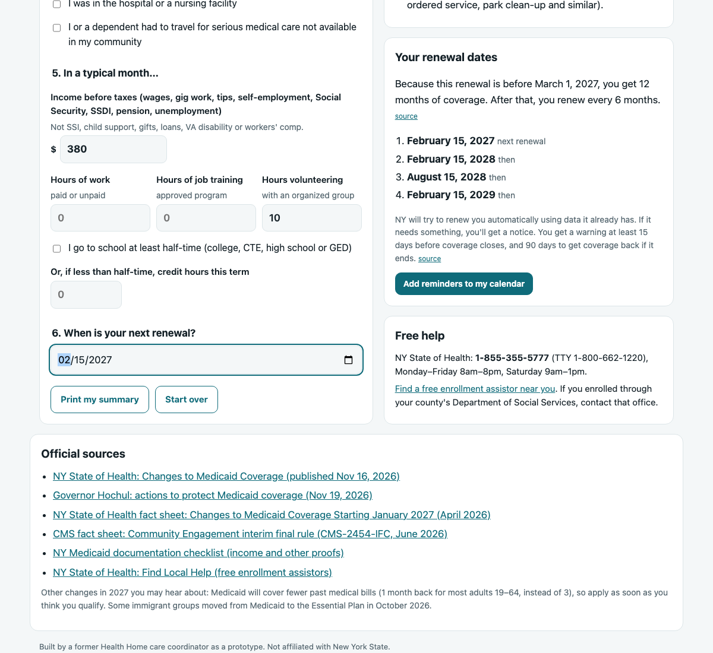

# Medicaid Renewal Buddy (New York)

**Live: https://medicaid-buddy.vercel.app**

A plain-language helper for New York Medicaid members facing the 2027 changes. Answer a
few questions to see:
- **whether the new work requirement applies to you** (80 hours a month, or $580 income);
- **whether you qualify for an exception**, permanent or temporary;
- **what to have ready** before you renew;
- **when you renew**, under the new six-month cycle, with reminders you can download to
  your calendar.

Every rule links to its official source. It's an educational tool, not legal advice.
Nothing you enter is saved or sent.

**Who feels the pain:** about 2 million New Yorkers in the affected group. NYC's mayor
says more than 900,000 New York City residents are at risk of losing coverage. The
navigators, Health Home care coordinators and legal aid advocates who help them are
also stretched. **Who would pay:** health plans, Health Homes and community-based
organisations that need to keep members covered, plus navigator programmes. New York
is funding $42.6M a year in navigator contracts.

## The rules it uses (checked November 21, 2026)

| Rule | Source |
|---|---|
| **Who is affected:** adults 19–64, not on Medicare | [NY State of Health, Nov 16, 2026](https://info.nystateofhealth.ny.gov/stay-covered) |
| **What meets it:** 80 hours a month of work, half-time school, job training or volunteering (any mix), or $580 a month in income | same |
| **Income converts to hours at $7.25:** for example, $380 = 52 hours, plus 28 volunteer hours = 80 | same (NY's own worked example) |
| **Credit hours:** less than half-time, each credit hour = 13 hours a month | same |
| **12 permanent exceptions,** in New York's wording: pregnant or postpartum, disability, health condition, Medicare, American Indian / Alaska Native, caregiver of a child under 14 or a disabled person, SNAP, Public Assistance, substance use disorder treatment, jail or recent release, foster care, veteran with total disability | same; [CMS IFR fact sheet](https://www.cms.gov/newsroom/fact-sheets/medicaid-community-engagement-requirement-certain-individuals-interim-final-rule-comment-period-cms) |
| **Temporary exceptions:** hospital or nursing facility, travel for serious medical care, disaster area, high-unemployment area, **with a planned exception for the Bronx** | NY State of Health |
| **Hold harmless:** no one loses coverage for not meeting the work requirement through **June 30, 2027** | [Governor's office, Nov 19, 2026](https://www.governor.ny.gov/news/governor-hochul-takes-actions-protect-medicaid-coverage-nearly-2-million-new-yorkers) |
| **Six-month renewals:** apply before Jan 1, 2027 or renew before Mar 1, 2027 → 12 months of coverage, then every 6 months; after those dates → every 6 months. American Indian / Alaska Native members and people with disabilities renew yearly. | NY State of Health |
| **Verification:** data match with IRS and state records (say yes); Truv income tool from Feb 2027; no documents unless requested; self-attestation for medical-condition exceptions in 2027 | same |

## How it works

It is a static site:
- **`rules.js`** holds every number and exception, each tied to its source;
- **`app.js`** runs the questionnaire, the exception and hours checks, the document
  checklist, the renewal dates, and the `.ics` calendar reminders (30 days before each
  renewal, and on the day).

Tested against New York's own worked example ($380 + 28 hours = 80) and each branch:
- **Exceptions:** age, Medicare, permanent exceptions, temporary exceptions, the Bronx.
- **Hours:** meets the requirement, or falls short.
- **Renewal timing:** dates before and after Mar 1, 2027, and yearly renewals for
  American Indian / Alaska Native members.

## Limits

- The rules change. A November 13, 2026 CMS letter created the hold-harmless option,
  so check `rules.js` against the sources before relying on it.
- It covers members enrolled through NY State of Health. People enrolled through their
  county's Department of Social Services should contact that office.
- English only for now.

Not affiliated with New York State. Built as part of a personal "vibe coding" practice
roadmap (Real problems track, #2).
